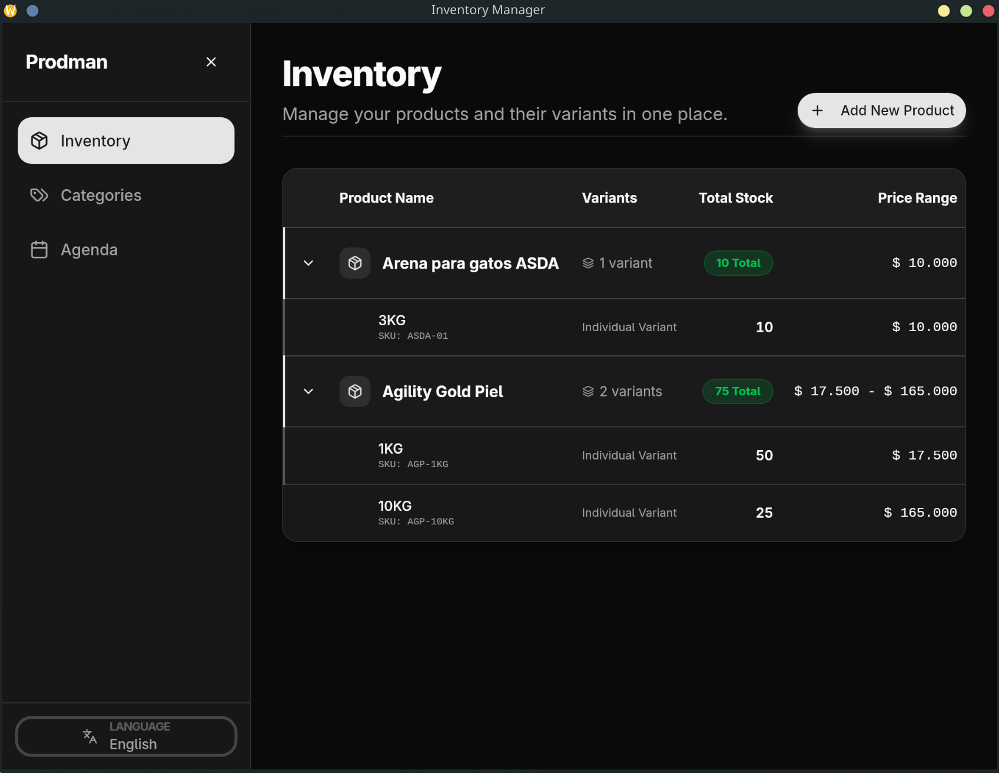

Prodman is the inventory system a pet shop in Colombia uses to run its counter. It tracks stock, purchases from providers, sales at the till and expiry dates on food, and it runs on whatever machine the shop already has, Linux or Windows.

## Why a desktop app

The shop needed something that works when the internet doesn't. Wails compiles the Go backend and the React frontend into one native binary, and all data lives in a SQLite file next to it: no server to host, no latency, nothing to break offline. Windows installers are built by a GitHub Actions workflow on every tagged release.

## How it's built

- **Go backend, ports and adapters.** The domain (products, variants, purchases, sales, providers) knows nothing about the database or the UI. Repositories use GORM over SQLite, and the schema evolves through versioned Goose migrations.
- **Wails bridge.** Go methods are exposed to the frontend as typed TypeScript functions, so there's no HTTP layer to maintain between the two halves.
- **React frontend.** TanStack Query handles caching and refetching, the UI is built on shadcn components, and it ships in Spanish by default with English available. Prices are shown in Colombian pesos.

## Modelling the shop, not a spreadsheet

A pet shop sells the same food in 1 kg, 3 kg and 10 kg bags, so the catalogue splits a **product** (name, brand, category) from its **variants** (SKU, sizing, price, stock, expiry). Purchases, sales and stock all resolve to the variant, and sales snapshot their line items so history survives later edits to the catalogue.

Expiry was the subtle part. Real expiry dates belong to batches, but a batches table would have turned stock into a sum of lots and forced first-expired-first-out logic onto the till, for a shop that usually sells one delivery down before the next arrives. Instead each variant keeps the date printed on its most recently received batch, written only when a purchase is recorded, and the warning is suppressed once stock hits zero so a date never outlives the goods it describes. I wrote that trade-off down as an ADR in the repo.
