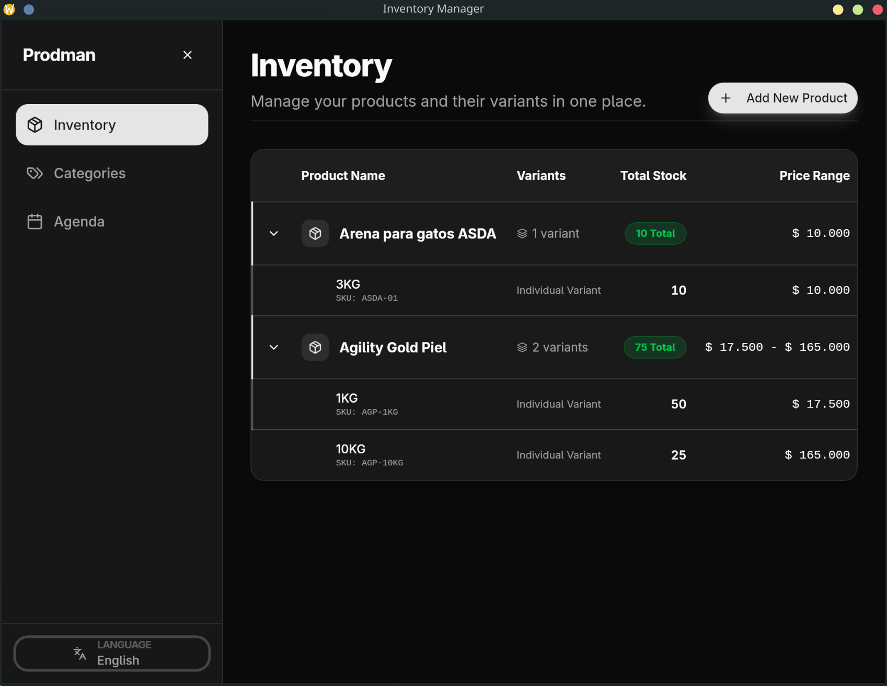

Prodman es el sistema de inventario con el que una tienda de mascotas en Colombia maneja su mostrador. Lleva el stock, las compras a proveedores, las ventas en caja y las fechas de vencimiento de los alimentos, y corre en el equipo que la tienda ya tiene, sea Linux o Windows.

## Por qué una app de escritorio

La tienda necesitaba algo que funcionara aunque se cayera el internet. Wails compila el backend en Go y el frontend en React en un solo binario nativo, y todos los datos viven en un archivo SQLite a su lado: no hay servidor que mantener, no hay latencia y nada se rompe sin conexión. Los instaladores de Windows se generan con un workflow de GitHub Actions en cada release etiquetado.

## Cómo está construido

- **Backend en Go, puertos y adaptadores.** El dominio (productos, variantes, compras, ventas, proveedores) no sabe nada de la base de datos ni de la interfaz. Los repositorios usan GORM sobre SQLite, y el esquema evoluciona con migraciones versionadas de Goose.
- **Puente de Wails.** Los métodos de Go se exponen al frontend como funciones tipadas de TypeScript, así que no hay una capa HTTP que mantener entre las dos mitades.
- **Frontend en React.** TanStack Query maneja la caché y las recargas, la interfaz usa componentes de shadcn, y viene en español por defecto con inglés disponible. Los precios se muestran en pesos colombianos.

## Modelar la tienda, no una hoja de cálculo

Una tienda de mascotas vende el mismo concentrado en bolsas de 1 kg, 3 kg y 10 kg, así que el catálogo separa el **producto** (nombre, marca, categoría) de sus **variantes** (SKU, presentación, precio, stock, vencimiento). Compras, ventas y stock se resuelven siempre a la variante, y cada venta guarda una copia de sus líneas para que el histórico sobreviva a cambios posteriores en el catálogo.

El vencimiento fue la parte delicada. Las fechas reales pertenecen a los lotes, pero una tabla de lotes habría convertido el stock en una suma de lotes y obligado a la caja a descontar primero lo que vence primero, para una tienda que normalmente vende un pedido antes de que llegue el siguiente. En cambio, cada variante guarda la fecha impresa en el lote recibido más reciente, que solo se escribe al registrar una compra, y la alerta se suprime cuando el stock llega a cero para que una fecha nunca sobreviva a la mercancía que describe. Dejé esa decisión documentada como un ADR en el repositorio.
