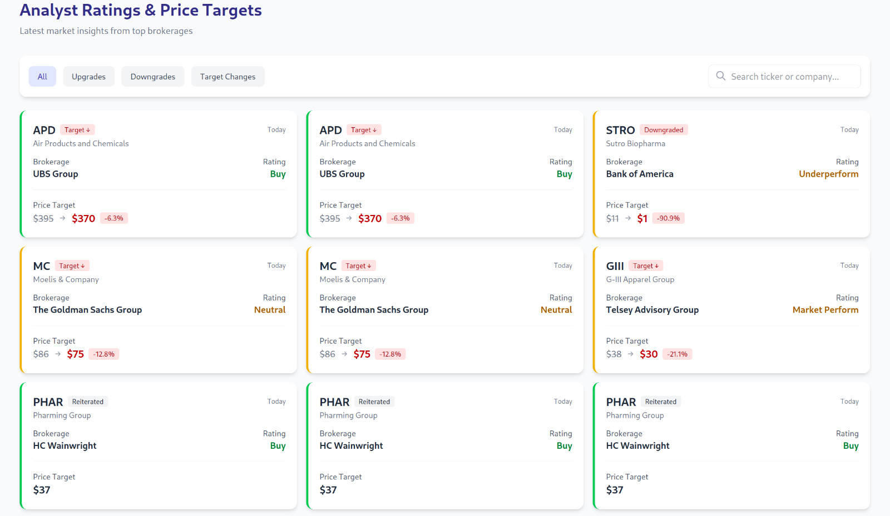

The recommender is three deployables that only talk over HTTP, with a distributed SQL database underneath. The market data is synthetic, generated by the worker, so the interesting part is the plumbing, not the predictions.

## The three services

- **stock-worker (Go).** A lightweight scraper that pulls price data from fixed endpoints and posts it to the API. It owns nothing except fetching; if it dies, the rest keeps serving history.
- **stock-recommender (Go, `net/http`).** The REST API. It ingests what the worker sends, computes trends against configurable thresholds and percentage changes, and emits a buy, hold or sell recommendation for each ticker.
- **stock-visualizer (Vue.js).** A single-page app that reads the API with Axios and renders ratings, price-target moves and charts.

## Why CockroachDB

Price history and recommendation logs are append-heavy and naturally keyed by ticker and time. CockroachDB gives Postgres-compatible SQL on a distributed, fault-tolerant store, so the API's queries stay plain SQL while the storage layer is built to scale out.

## Next steps

The service boundaries are the point of the design: the worker can be swapped for one that reads real market data without touching the API, and the API's contract is the only thing the frontend depends on. Live data and richer analytics would slot in behind those same interfaces.
