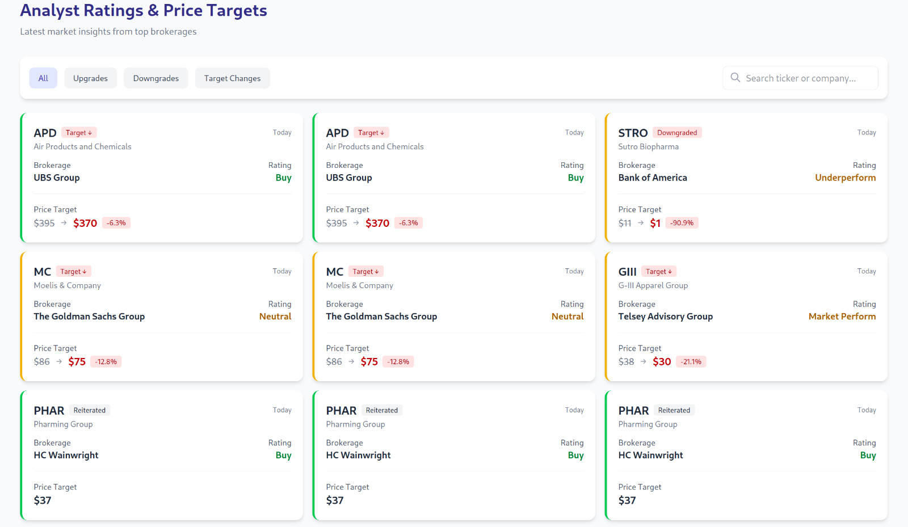

El recomendador son tres desplegables que solo se hablan por HTTP, con una base de datos SQL distribuida debajo. Los datos de mercado son sintéticos, generados por el worker, así que lo interesante es la plomería, no las predicciones.

## Los tres servicios

- **stock-worker (Go).** Un scraper liviano que obtiene precios de endpoints fijos y los envía a la API. Solo se encarga de traer datos; si se cae, lo demás sigue sirviendo el histórico.
- **stock-recommender (Go, `net/http`).** La API REST. Ingiere lo que envía el worker, calcula tendencias con umbrales y variaciones porcentuales configurables, y emite una recomendación de compra, retención o venta por ticker.
- **stock-visualizer (Vue.js).** Una SPA que consume la API con Axios y muestra calificaciones, cambios de precio objetivo y gráficas.

## Por qué CockroachDB

El histórico de precios y el registro de recomendaciones son de escritura intensiva y se indexan naturalmente por ticker y tiempo. CockroachDB ofrece SQL compatible con Postgres sobre un almacenamiento distribuido y tolerante a fallos, así que las consultas de la API siguen siendo SQL simple mientras la capa de datos está hecha para escalar horizontalmente.

## Siguientes pasos

Los límites entre servicios son el punto del diseño: el worker se puede reemplazar por uno que lea datos reales de mercado sin tocar la API, y el contrato de la API es lo único de lo que depende el frontend. Datos en vivo y análisis más avanzados encajarían detrás de esas mismas interfaces.
