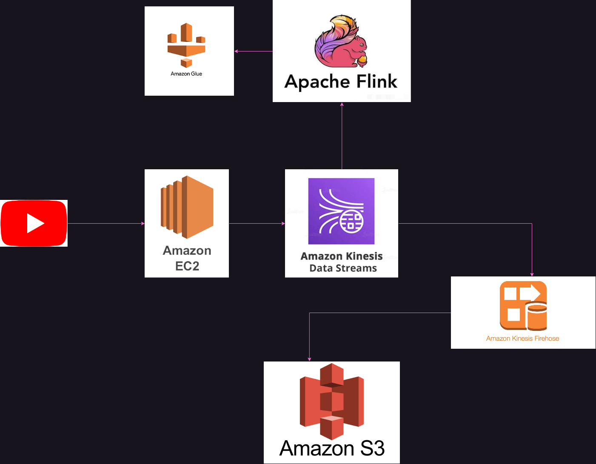
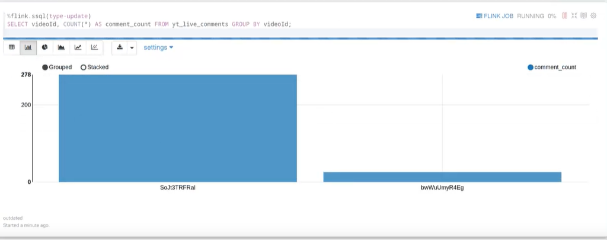

Live chat on a popular YouTube stream is a small firehose: bursty, unbounded, and gone if you don't catch it. I built this with two classmates for a big-data course at EAFIT to answer a simple question end to end: how do you capture an unbounded stream once and use it twice, cheaply stored and queryable in real time?

## Architecture



- **Collector (EC2, Python/Flask).** A small HTTP service takes a live-stream ID and starts pulling its chat with `pytchat`, pushing every message to Kinesis with `boto3`.
- **Kinesis Data Streams** is the single ingestion point. Everything downstream reads from it, so adding a consumer never touches the collector.
- **Raw path: Kinesis Firehose → S3.** Firehose batches records into the data lake untouched, so any later analysis can replay the raw history.
- **Hot path: Apache Flink.** Flink SQL (in a Kinesis Data Analytics Studio notebook) reads the same stream, with the schema registered in the Glue Data Catalog, and keeps running aggregates.

## Querying the stream

The simplest useful query counts comments per stream, updating continuously as messages arrive:

```sql
SELECT videoId, COUNT(*) AS comment_count
FROM yt_live_comments
GROUP BY videoId;
```



## What I'd do differently

The hot path never persisted its results: Flink's aggregates lived only in the notebook. Today I'd write them to a sink table (or back to S3 as Parquet) and treat the notebook as a viewer, not the system of record. I'd also put the collector behind a queue of stream IDs instead of a single HTTP call, so it could follow several streams and survive restarts.
