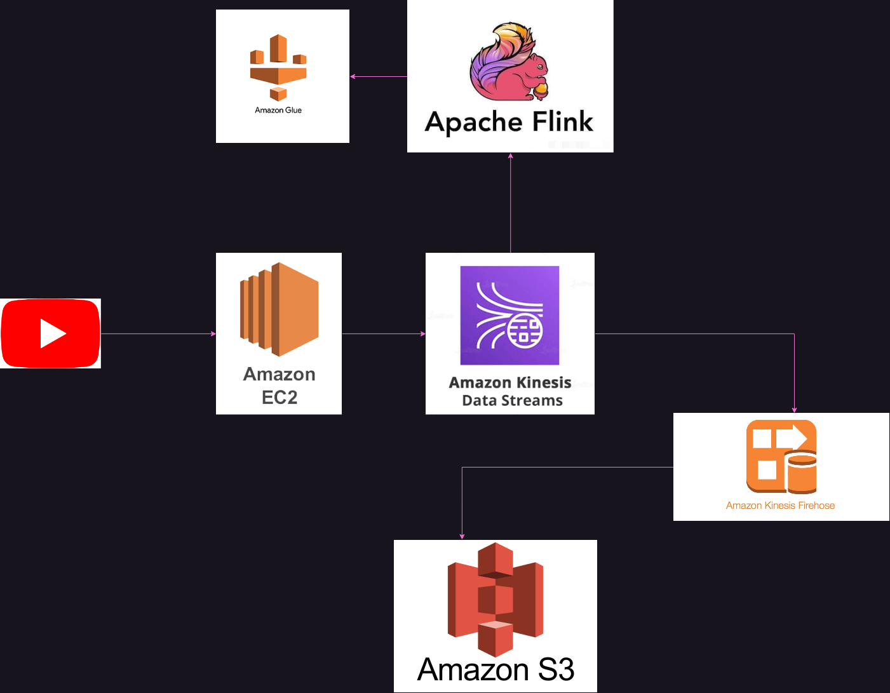
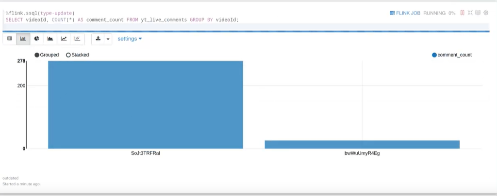

El chat en vivo de una transmisión popular de YouTube es un pequeño torrente: en ráfagas, sin fin, y perdido si no lo capturas. Lo construí con dos compañeros para un curso de big data en EAFIT, para responder una pregunta concreta de principio a fin: ¿cómo capturas un flujo sin fin una sola vez y lo usas dos veces, almacenado a bajo costo y consultable en tiempo real?

## Arquitectura



- **Recolector (EC2, Python/Flask).** Un servicio HTTP pequeño recibe el ID de una transmisión y empieza a leer su chat con `pytchat`, enviando cada mensaje a Kinesis con `boto3`.
- **Kinesis Data Streams** es el único punto de ingesta. Todo lo demás lee de ahí, así que agregar un consumidor nunca toca el recolector.
- **Ruta en frío: Kinesis Firehose → S3.** Firehose agrupa los registros en el data lake sin transformarlos, para que cualquier análisis posterior pueda reprocesar el histórico.
- **Ruta en caliente: Apache Flink.** Flink SQL (en un notebook de Kinesis Data Analytics Studio) lee el mismo flujo, con el esquema registrado en el Glue Data Catalog, y mantiene agregaciones continuas.

## Consultando el flujo

La consulta útil más simple cuenta comentarios por transmisión, actualizándose a medida que llegan:

```sql
SELECT videoId, COUNT(*) AS comment_count
FROM yt_live_comments
GROUP BY videoId;
```



## Qué haría distinto

La ruta en caliente nunca persistió sus resultados: las agregaciones de Flink vivían solo en el notebook. Hoy las escribiría en una tabla destino (o de vuelta a S3 en Parquet) y usaría el notebook como visor, no como fuente de verdad. También pondría el recolector detrás de una cola de IDs de transmisión en lugar de una sola llamada HTTP, para seguir varias transmisiones y sobrevivir a reinicios.
